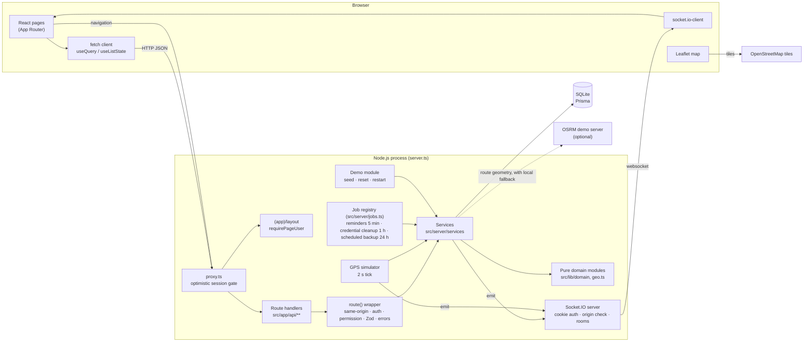
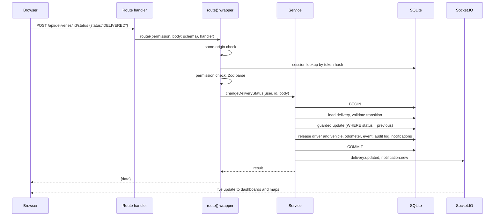
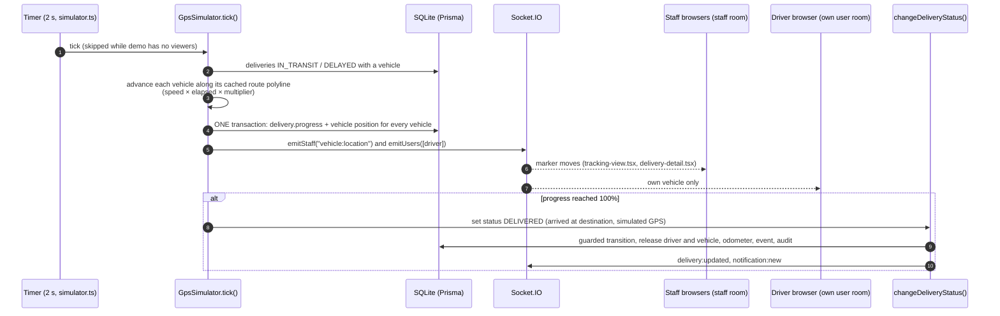
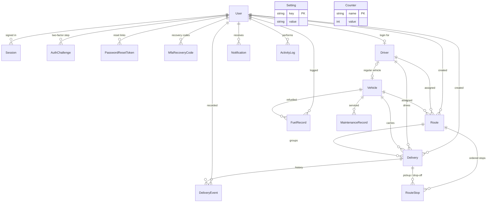
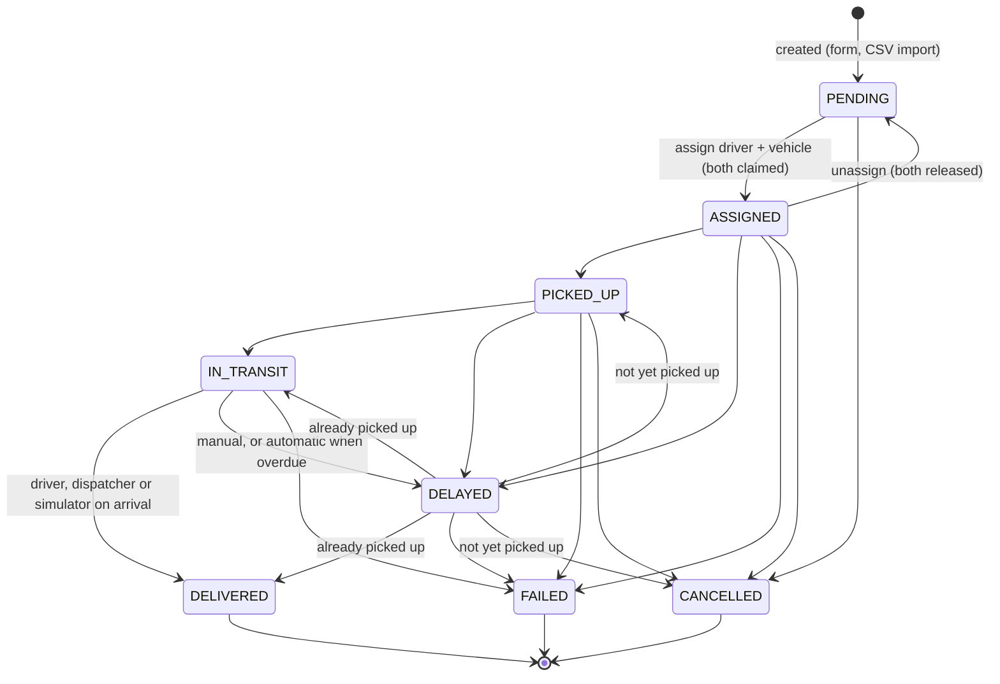
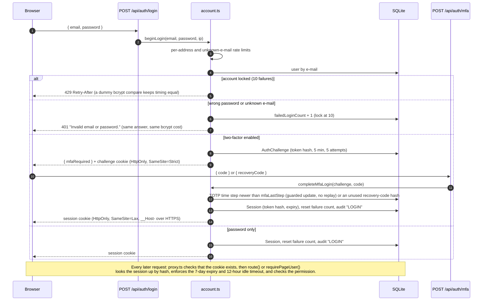
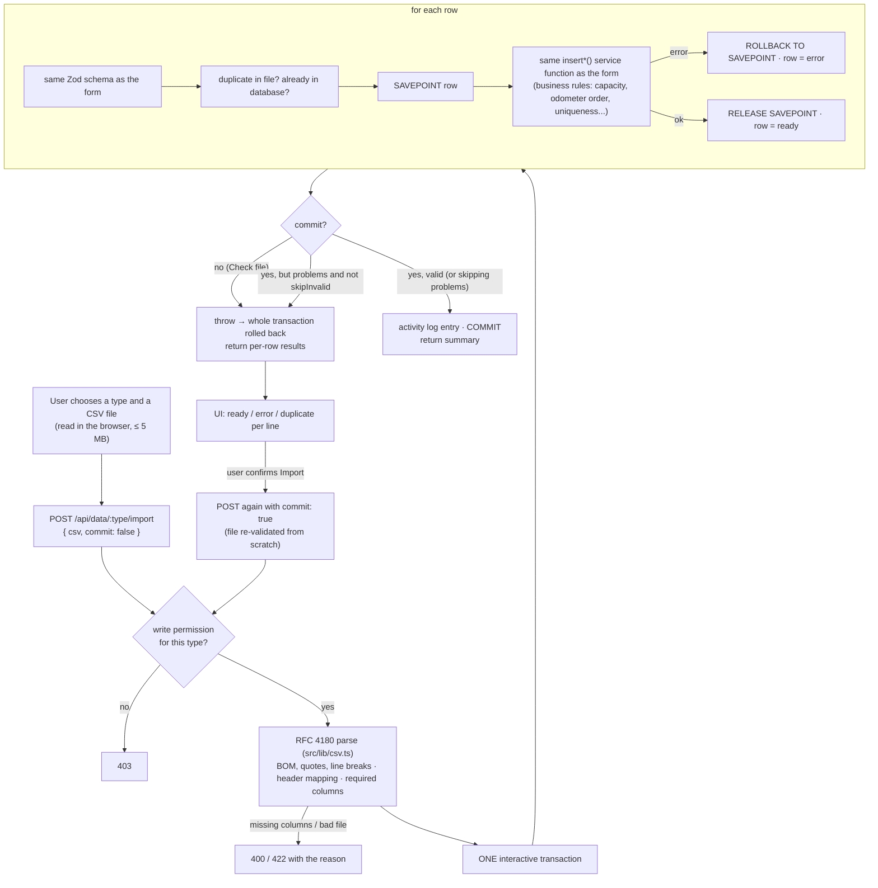

# Architecture

LogiTrack is a single Node.js process that serves a Next.js application, a REST API, a Socket.IO realtime channel, a GPS simulator and a small registry of background jobs, backed by one SQLite database. This document explains how the pieces fit and why they are arranged this way. Every diagram describes code that exists in this repository; file paths are given so each claim can be checked.

Diagrams: [1. system](#system-overview) · [2. data model](#data-model) · [3. delivery lifecycle](#delivery-lifecycle) · [4. live tracking](#live-tracking-data-flow) · [5. authentication](#authentication-flow) · [6. CSV import](#csv-import-workflow)

## System overview

## Frontend architecture

- **App Router, two kinds of page.** Public pages (`src/app/page.tsx` landing, `src/app/login`, `src/app/reset-password`) and the signed-in area `src/app/(app)/**`. Every signed-in page is a small **server component** that calls `requirePageUser(permission)` (`src/lib/auth-server.ts`) and renders a **client view** (`*-view.tsx`) that does the interactive work.
- **Shell and context.** `src/app/(app)/layout.tsx` loads the user once. `src/components/app/providers.tsx` provides the user, a `useCan()` permission hook, demo state and **one shared Socket.IO connection**; views subscribe with `useSocketEvent(event, handler)`. `src/components/app/shell.tsx` renders the sidebar (built from `nav.ts` and filtered by permission), the header, the demo banner and the guided tour (`tour.tsx`).
- **Data fetching.** A small typed client in `src/lib/client.ts` (`api.get/post/...`, `useQuery`, `useListState` for paging, sorting and filters in the URL). Errors arrive as `ApiClientError` with per-field messages for forms. A 401 sends the browser to `/login?next=...`.
- **Forms** share the API's Zod schemas from `src/lib/validation.ts`, so the browser shows the same messages the server would return.
- **UI building blocks.** Radix primitives in `src/components/ui`, the app-level `DataTable`, `PageHeader`, `StatusBadge` and chart wrappers in `src/components/app`, and the Leaflet map (client-only) in `src/components/map`.

## API organisation

- 76 route files under `src/app/api/**/route.ts`, grouped by resource: `auth`, `profile`, `users`, `vehicles`, `drivers`, `deliveries`, `tracking`, `simulator`, `routes`, `fuel`, `maintenance`, `notifications`, `dashboard`, `analytics`, `performance`, `intelligence`, `reports`, `data` (import/export), `activity`, `settings`, `backups`, `diagnostics`, `health`, `demo`, `csp-report`, `reminders`. Every endpoint is listed in [API.md](API.md).
- Each handler is wrapped by `route(options, handler)` from `src/lib/api.ts`, which does the same-origin check, loads the session, applies the per-user write limit, checks the permission, parses the body with Zod and maps errors. Handlers return plain data (sent as `{ data }`) or a `Response` (CSV, file downloads).
- Lists share one query convention (`page`, `pageSize` up to 200, `sort`, `dir`, `q`, `from`, `to`) parsed by `src/lib/list.ts`, with sort columns whitelisted per resource.

## Layers

| Layer | Location | Responsibility | Knows about |
| --- | --- | --- | --- |
| Pages | `src/app/(app)/**`, `src/app/page.tsx`, `src/app/login` | Server component per page that guards access, plus a client view that renders and calls the API | API contracts, UI components |
| UI components | `src/components/ui`, `src/components/app`, `src/components/forms`, `src/components/map`, `src/components/marketing` | Design-system primitives and app-level building blocks | Nothing about the database |
| Route handlers | `src/app/api/**/route.ts` | Declare the permission and Zod schema, call one service function | Services |
| Route wrapper | `src/lib/api.ts` | Same-origin check, authentication, permission check, body validation, error mapping | Auth, permissions |
| Services | `src/server/services/*.ts` | Business rules, transactions, audit log, notifications, realtime events | Prisma, domain modules |
| Domain | `src/lib/domain/*.ts`, `src/lib/geo.ts` | Pure functions: state machine, fuel maths, scoring, reminders, risk, utilisation, recommendations, comparisons, route optimisation | Nothing (no I/O) |
| Infrastructure | `server.ts`, `src/server/simulator.ts`, `src/lib/realtime.ts`, `src/lib/db.ts` | HTTP + websocket hosting, simulation loop, Prisma client | Services |

The rule that keeps this tidy: **dependencies only point downwards**. Domain modules import nothing with side effects, so every calculation in the product can be unit-tested with plain objects. Services never import from `next/*`, so they run unchanged inside the API, the simulator, the seed script and the tests.

## A request, end to end

## Authorisation in depth

Access is checked in four places, each closer to the data than the last:

1. **`proxy.ts`** redirects requests without a session cookie before any page work happens (a convenience, not a control).
2. **Page guard** (`requirePageUser(permission)`) validates the session and the role on the server for every page.
3. **API guard** (`route({ permission })`) does the same for every endpoint.
4. **Data scope** inside services: for example a driver's delivery queries are ANDed with `driverId = their own`, so no query parameter or guessed ID can widen them.

The permission matrix lives in one file, `src/lib/permissions.ts`, and is shared by server and client. The client uses it only to hide controls.

## Realtime

- Socket.IO is attached to the same HTTP server as Next.js.
- The handshake must come from the app's own origin and carry a valid session cookie.
- Staff sockets join a fleet room; every socket joins its own user room. Drivers therefore receive only events addressed to them.
- When sessions are revoked (logout, deactivation, password or role change) the affected sockets are disconnected immediately; a periodic re-check covers expiry.

Events: `vehicle:location`, `delivery:updated`, `notification:new`, `simulator:state`, `demo:reset` (`EVENTS` in `src/lib/realtime.ts`). Services publish through `emitStaff` / `emitUser` / `emitUsers`, which reach the server instance through `globalThis`, so code bundled by Next.js and code run by `tsx` share one Socket.IO server.

### Live tracking data flow

## Background jobs

**GPS simulator** (`src/server/simulator.ts`). Every two seconds each vehicle with a delivery in transit advances along that delivery's route polyline by the distance it would cover at the configured speed, the position is saved, and an event is broadcast. On arrival the delivery is completed through the same service function a person would trigger. In demo mode a *gate* pauses the clock while no client is connected, so sample trips do not finish while nobody is watching.

**Reminder sweep** (`src/server/services/reminders.ts`). Every five minutes it turns time-based conditions into persisted notifications (maintenance due, documents expiring) and flags overdue deliveries as delayed. De-duplication keys make it safe to run any number of times.

**Job registry** (`src/server/jobs.ts`, 3.0). The reminder sweep, the credential cleanup (expired sessions, sign-in challenges, reset links; hourly) and scheduled backups (`BACKUP_INTERVAL_HOURS`) are registered jobs. A job never overlaps itself, and its last run, duration, result and error are shown on the Diagnostics page. Failures are logged and never stop the server. Since 3.0 the simulator writes all positions of a tick in one transaction and caches parsed route geometry.

## Start-up and shutdown

`server.ts` starts in a deliberate order, so a failed start never leaves work running in the background:

1. Validate `PORT`. Check that the port is free on all interfaces and on `HOSTNAME_BIND` (default `localhost`). If it is not, report the holding process (`src/server/startup.ts`; Windows: `Get-NetTCPConnection`; elsewhere: `lsof`) and exit 1. Nothing is ever stopped automatically.
2. Claim `<database>.server.lock` (PID, port, start time). If a live LogiTrack server holds it, exit 1 with its details. A lock from a dead process is replaced.
3. Prepare Next.js, create Socket.IO, and `listen` (as a promise; errors are handled, not thrown into Next's uncaught-exception handler).
4. Only now start the GPS simulator and schedule the jobs.

Shutdown (SIGINT/SIGTERM): pause the simulator, stop every job timer, close Socket.IO and the HTTP server, release the lock, and disconnect Prisma, with a 5-second forced exit as a backstop.

## Operations (3.0)

- **Logging** (`src/lib/logger.ts`): one JSON object per line in production. Secret-looking fields are redacted and e-mail addresses masked before anything is written. Warnings and errors also go into an in-memory ring buffer for the Diagnostics page. Every API response carries an `X-Request-Id` that matches the server log entry.
- **Security middleware** (`src/proxy.ts`): a per-request CSP nonce for pages. The root layout reads the request headers, so every page renders dynamically with the nonce.
- **Account security** (`src/server/services/account.ts`): the sign-in state machine (password → optional two-factor challenge → session), lockout, enrolment, recovery codes, reset links and re-authentication. Secret material uses `src/lib/crypto.ts` (AES-256-GCM, HKDF).
- **Backups** (`src/server/services/backup.ts`): `VACUUM INTO`, verification on a separate connection, and restore on a dedicated single-connection client with `ATTACH` and `BEGIN IMMEDIATE`, so the whole restore is one SQLite transaction.
- **Import** (`src/server/services/imports.ts`): each row goes through the entity's Zod schema and the same `insert*` service function as the forms, inside one interactive transaction, with a SAVEPOINT per row so row-level failures are reported without affecting other rows. A preview always rolls back.

## Error handling and observability

- **One error shape.** Services throw `ApiError` (`src/lib/errors.ts`: `badRequest`, `forbidden`, `notFound`, `conflict`, `tooMany`). `errorResponse()` in `src/lib/api.ts` maps everything to `{ error: { code, message, fieldErrors? } }`: Zod errors become 422 with per-field messages, Prisma unique violations 409, missing records 404, foreign-key conflicts 409, rate limits 429 with `Retry-After`. Anything unexpected becomes a 500 with a generic message and a **request ID**; the stack trace and SQL stay in the server log.
- **Every response** carries `X-Request-Id` and, for the API, `Cache-Control: no-store`.
- **Structured logging** (`src/lib/logger.ts`): JSON lines in production, a readable format in development. Secret-like fields are redacted and e-mail addresses masked before anything is written. Warnings and errors also go into an in-memory ring buffer (200 entries) shown on the Diagnostics page.
- **Diagnostics** (`src/server/services/diagnostics.ts`, Super Admin): database integrity and size, websocket counts, simulator ticks and failures, every job's last run and error, memory, recent problems. `/api/health` is the public liveness probe (status, version, database).
- **Pages:** `src/app/(app)/error.tsx` is the error boundary, with a retry, for the signed-in area.

## Intelligence engines

All "intelligence" is deterministic rules over stored records, implemented as pure functions and documented in [FEATURES.md](FEATURES.md):

| Engine | Module | Input | Output |
| --- | --- | --- | --- |
| Delivery risk | `domain/risk.ts` | schedule, progress, distance, history | Low / Medium / High with reasons |
| Fleet utilisation | `domain/utilization.ts` | deliveries, maintenance | active, idle, downtime, under-used vehicles with explanations |
| Fuel efficiency | `domain/fuel-intel.ts` | fuel fills | mileage, trend, peer comparison, data-quality flags |
| Maintenance recommendations | `domain/maintenance-intel.ts` | odometer, service history, usage | suggested next routine service |
| Driver performance | `domain/performance.ts` | closed deliveries | score, rates, 30-day trend |
| Period comparison | `domain/compare.ts` + `services/analytics.ts` | two periods | deltas and plain-language explanations |

No external AI or analytics service is involved.

## Data model

Seventeen Prisma models (`prisma/schema.prisma`), three migrations. The diagram shows every model and relation; columns and indexes are in [DATABASE.md](DATABASE.md).

`Setting` holds system settings (simulation speed, reminder windows, company name). `Counter` issues the human-readable codes (VEH-0001, DEL-0001, ...) inside the creating transaction.

Two decisions shape most of the code:

- **Derived data is never stored.** Scores, mileage, utilisation, risk and dashboard figures are computed on demand, so they cannot drift from the records.
- **History is never orphaned.** Vehicles, drivers and users are soft-deleted; deliveries with operational history cannot be deleted.

## Delivery lifecycle

The state machine is `allowedTransitions()` in `src/lib/domain/delivery-status.ts`; `changeDeliveryStatus()` and `assignDelivery()` in `src/server/services/deliveries.ts` enforce it.

The reminder sweep (every 5 minutes) moves Assigned, Picked Up and In Transit deliveries past their expected time to Delayed automatically.

Every transition writes a `DeliveryEvent`, an activity-log entry and, where relevant, notifications. Entering a terminal state (Delivered, Failed, Cancelled) releases the driver and vehicle in the same transaction; Delivered also adds the trip distance to the odometer and parks the vehicle at the destination. Drivers can only move their own deliveries, and cannot cancel.

## Consistency under concurrency

Every multi-step change runs in a single transaction. On top of that, the writes that matter most are *guarded*:

- Claiming a driver or vehicle is a conditional update (`WHERE status = 'AVAILABLE'`); if another request took it first the row no longer matches and the transaction aborts.
- A status transition is a conditional update on the previous status, so the same transition sent twice applies once.

These are covered by race tests in `tests/integration/security.test.ts`.

## Authentication flow

Sessions are opaque random tokens; only their SHA-256 is stored (`src/lib/auth.ts`). The sign-in state machine is `beginLogin()` and `completeMfaLogin()` in `src/server/services/account.ts`.

Sessions are destroyed on logout, password change or reset, role change, deactivation, two-factor changes and database restore. `onSessionsRevoked` disconnects the affected websockets at the same moment.

## CSV import workflow

`runImport()` in `src/server/services/imports.ts`; the UI is `src/app/(app)/import-export/import-export-view.tsx`.

## Why these choices

| Decision | Reason |
| --- | --- |
| Custom server instead of `next start` | Socket.IO and the simulator need a long-lived process; one port and one command keep local setup trivial. |
| SQLite | Zero setup and zero cost. Prisma keeps the model portable to PostgreSQL. |
| Services separate from route handlers | The same rules are used by HTTP, the simulator, the seed and the tests. |
| Zod schemas shared by forms and API | One definition of "valid", instant feedback in the form, authoritative check on the server. |
| Rule engines instead of ML | Explainable, testable, free, and honest about uncertainty. |
| Radix primitives with local components | Accessible behaviour without a paid kit or a generated-code step. |
| Local routing maths with optional OSRM | The app works offline; real road geometry is an enhancement, never a dependency. |

## Zero-cost technology map

| Need | Typical paid option | What LogiTrack uses |
| --- | --- | --- |
| Maps | Google Maps Platform | Leaflet + OpenStreetMap tiles |
| Routing | Directions API | Haversine, nearest neighbour and 2-opt locally; optional public OSRM demo server |
| Geocoding | Places API | Built-in gazetteer, map click, coordinates |
| Vehicle telemetry | GPS hardware and a telematics subscription | Built-in simulator, labelled as simulated |
| Database | Managed cloud database | SQLite file |
| Authentication | Hosted identity provider | bcrypt + database sessions |
| Realtime | Hosted pub/sub | Socket.IO in-process |
| Insights | AI or BI service | Local rule engines |
| Hosting | Cloud platform | Runs locally |
