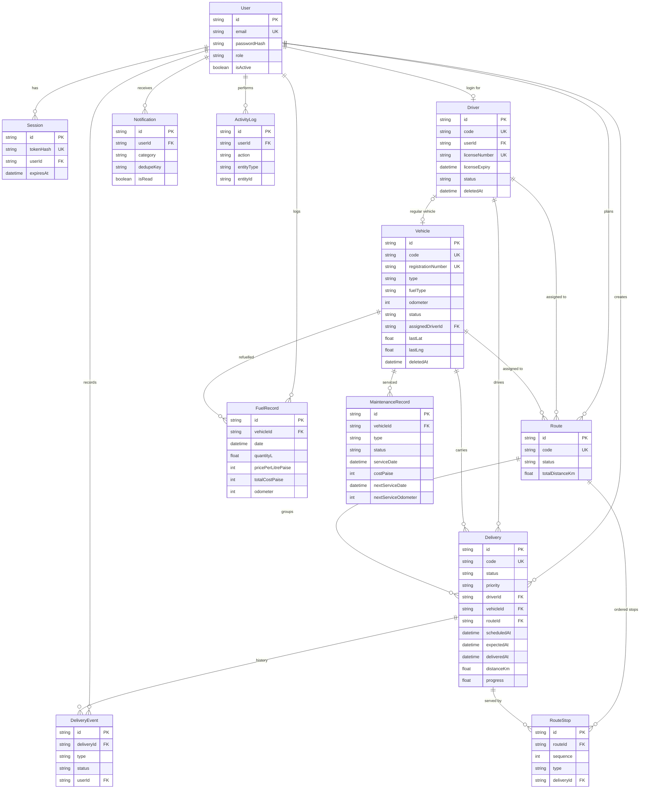
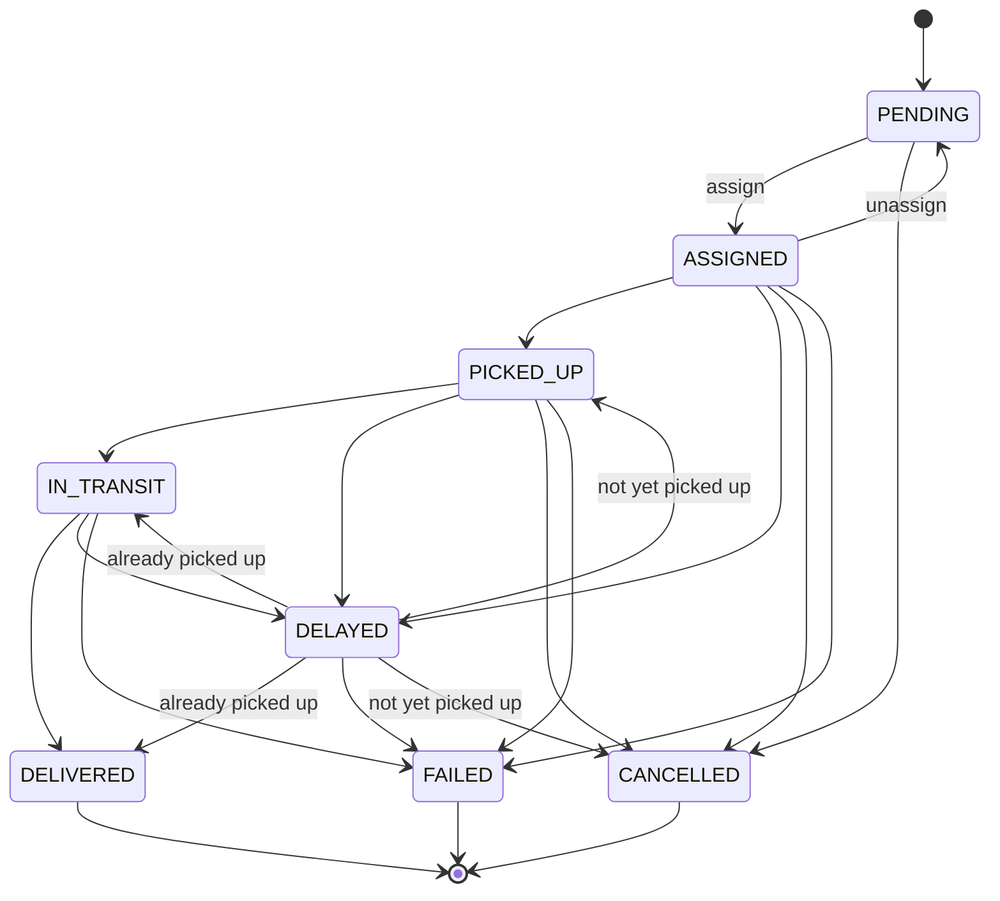

# Database

LogiTrack uses **SQLite** through **Prisma**. The schema lives in [`prisma/schema.prisma`](../prisma/schema.prisma) and is versioned with migrations in `prisma/migrations/`.

## Entity-relationship diagram



`Setting` (key/value configuration) and `Counter` (sequential code issuer) are standalone tables.

## Conventions

| Topic | Convention |
| --- | --- |
| Primary keys | `id`: collision-resistant string (`cuid`) |
| Human-readable IDs | `code`: unique, sequential per entity (`VEH-0001`, `DRV-0001`, `DEL-0001`, `RTE-0001`, `FUEL-0001`, `MNT-0001`), issued from `Counter` inside the creating transaction |
| Money | **Integer paise** (`…Paise` columns). ₹92.45 is stored as `9245`. No floating-point money anywhere. |
| Distance | Kilometres (`Float`); odometers are whole kilometres (`Int`) |
| Coordinates | WGS84 decimal degrees (`Float`) |
| Enumerations | SQLite has no enum type. Enum-like columns are `String`, validated by Zod against `src/lib/constants.ts` on every write |
| Timestamps | `createdAt` / `updatedAt` on mutable entities |
| Deletion | Vehicles, drivers and users are **soft-deleted** (`deletedAt` / `isActive`). History is never orphaned. |
| Derived data | **Not stored.** Driver statistics and scores, fuel efficiency, utilisation, delivery risk, recommendations, dashboard and report figures are computed from records on demand. |

## Models

### User
Login accounts. `email` is unique. `passwordHash` is a bcrypt hash and is never returned by the API. `role` is one of `SUPER_ADMIN`, `FLEET_MANAGER`, `DISPATCHER`, `DRIVER`. `isActive = false` blocks sign-in and invalidates sessions. Index: `role`.

3.0 account-security columns: `failedLoginCount` and `lockedUntil` (lockout after 10 failures), `passwordChangedAt`, and two-factor state: `mfaEnabled`, `mfaSecret` and `mfaPendingSecret` (AES-256-GCM ciphertext, never returned by the API), `mfaEnabledAt`, and `mfaLastStep` (the last accepted TOTP time step, for replay protection).

### Session
Server-side sessions. `tokenHash` (unique) is the SHA-256 of the random token held in the browser cookie, so a database leak cannot be replayed. `expiresAt` is enforced on every request; expired rows are purged hourly. `lastSeenAt` (3.0) drives the idle timeout and is written at most once a minute. Indexes: `userId`, `expiresAt`. Deleted with the user.

### AuthChallenge (3.0)
The short-lived step between a correct password and a two-factor code. `tokenHash` is the SHA-256 of the challenge cookie. `attempts` (maximum 5), `expiresAt` (5 minutes). Deleted with the user.

### PasswordResetToken (3.0)
One-time reset links. Only `tokenHash` is stored. `expiresAt` (60 minutes), `usedAt` (single use), `createdById`. Only the newest link per user exists. Deleted with the user.

### MfaRecoveryCode (3.0)
Ten per user, each a bcrypt `codeHash`, with `usedAt` set when consumed. Deleted with the user.

### Driver
`code`, `licenseNumber` and `email` are unique. `userId` (unique, optional) links to a `DRIVER` login. `status`: `AVAILABLE`, `ON_DELIVERY`, `OFF_DUTY`, `INACTIVE`. `ON_DELIVERY` is set and cleared only by the delivery workflow. Indexes: `status`, `licenseExpiry`.

### Vehicle
`code` and `registrationNumber` are unique. `type`: `TRUCK`, `MINI_TRUCK`, `VAN`, `PICKUP`, `BIKE`, `CONTAINER`. `fuelType`: `DIESEL`, `PETROL`, `CNG`, `ELECTRIC`. `status`: `AVAILABLE`, `ON_DELIVERY`, `MAINTENANCE`, `INACTIVE`. `assignedDriverId` is unique, which makes the driver ↔ vehicle pairing one-to-one. `lastLat`, `lastLng`, `lastHeading`, `lastLocationAt` hold the last (simulated) position. Indexes: `status`, `type`.

### Delivery
Customer, pickup and destination (address + coordinates), schedule (`scheduledAt`, `expectedAt`), actual times (`pickedUpAt`, `deliveredAt`, `closedAt`), `distanceKm`, `estimatedMinutes`, `priority` (`LOW`, `NORMAL`, `HIGH`, `URGENT`) and `status`.



`driverId` and `vehicleId` use `onDelete: Restrict`: a driver or vehicle with deliveries can never be hard-deleted. Tracking state: `progress` (0–1 along the route), `routeGeometry` (JSON polyline) and `geometrySource` (`local` or `osrm`).

Indexes: `status`, `scheduledAt`, `driverId`, `vehicleId`, `priority`, `closedAt`, `routeId`.

### DeliveryEvent
Append-only history of a delivery: `type` (`CREATED`, `ASSIGNMENT`, `STATUS_CHANGE`, `UPDATED`, `ISSUE`), resulting `status`, optional `note`, the acting `userId` (null for system events such as the simulator or automatic delay detection). Index: `(deliveryId, createdAt)`.

### Route and RouteStop
A saved multi-stop plan: `algorithm`, `totalDistanceKm`, `estimatedMinutes`, optional crew, `status` (`PLANNED`, `IN_PROGRESS`, `COMPLETED`, `CANCELLED`, kept in step with its deliveries). Each `RouteStop` has a `sequence` (unique per route), `type` (`START`, `PICKUP`, `DROPOFF`), label, coordinates, `legKm` from the previous stop and the delivery it serves.

### FuelRecord
`vehicleId`, `date`, `quantityL`, `pricePerLitrePaise`, `totalCostPaise` (quantity × price, rounded to the paisa, always computed on the server), `odometer`, `station`, `notes`. Validation on write: quantity must fit the tank; the odometer must lie between the previous and next fill of the same vehicle. Indexes: `(vehicleId, date)`, `date`.

### MaintenanceRecord
`vehicleId`, `type`, `description`, `serviceDate`, `status` (`SCHEDULED`, `IN_PROGRESS`, `COMPLETED`, `CANCELLED`), `costPaise`, `provider`, `odometer`, and the follow-up fields `nextServiceDate` / `nextServiceOdometer` that drive reminders. A vehicle is `MAINTENANCE` while any of its records is `IN_PROGRESS`. Indexes: `(vehicleId, serviceDate)`, `status`.

System-generated service *recommendations* are not rows in this table: they are computed on demand and only become a record when someone schedules them.

### Notification
Per-user rows: `category` (`DELIVERY`, `MAINTENANCE`, `COMPLIANCE`, `VEHICLE`, `SYSTEM`), `severity` (`INFO`, `SUCCESS`, `WARNING`, `CRITICAL`), `title`, `message`, optional entity link, `isRead`. `dedupeKey` with the unique constraint `(userId, dedupeKey)` guarantees that a recurring reminder is delivered to each user once. Index: `(userId, isRead, createdAt)`.

### ActivityLog
Audit trail: `userId` (nullable), `action`, `entityType`, `entityId`, `description`, `createdAt`. Indexes: `createdAt`, `(entityType, entityId)`, `userId`.

### Setting and Counter
`Setting` is a key/value store for system configuration (company name, simulation speed, reminder windows, and when the demo data was generated); missing keys fall back to defaults in `src/lib/constants.ts`. `Counter` issues the sequential `code` values.

## Integrity rules enforced in services

- A driver or vehicle can be assigned to a new delivery only when `AVAILABLE`; drivers also need a valid licence.
- **Claims are atomic.** Taking a driver or vehicle is a conditional update on its status, so two simultaneous assignments cannot both succeed.
- **Transitions are atomic.** A status change is a conditional update on the previous status, so the same change sent twice applies once.
- Assigning sets driver and vehicle to `ON_DELIVERY`; they return to `AVAILABLE` when their last active delivery closes.
- Completing a delivery adds its distance to the vehicle odometer and parks the vehicle at the destination.
- Only `PENDING` or `CANCELLED` deliveries can be deleted; completed maintenance cannot be deleted.
- Vehicles and drivers with active deliveries cannot be removed.
- The last active Super Admin cannot be demoted or deactivated.
- Multi-step changes run inside a single transaction together with their audit-log entries.

## Migrations

| Migration | Contents |
| --- | --- |
| `…_init` | All fourteen models, constraints and indexes |
| `…_add_delivery_indexes` | Indexes on `Delivery.closedAt` (dashboard and analytics filter closed deliveries by date) and `Delivery.routeId` (routes load their deliveries) |
| `…_v3_account_security` | Account-security columns on `User`, `Session.lastSeenAt`, and the `AuthChallenge`, `PasswordResetToken` and `MfaRecoveryCode` tables. Adds only. Existing rows are kept. |

Backups and restores are covered in [BACKUP_RESTORE.md](BACKUP_RESTORE.md). A restore only accepts a backup with exactly the same migrations.

## Working with the database

```bash
npm run db:migrate     # create + apply a migration after editing schema.prisma
npm run db:deploy      # apply existing migrations (CI / fresh clone)
npm run db:seed        # wipe and reseed demo data (demo accounts keep their IDs)
npm run db:studio      # browse data in Prisma Studio
```

Database files (`prisma/*.db`) are git-ignored. The test suites use their own files (`test.db`, `e2e.db`) and never touch `dev.db`.
